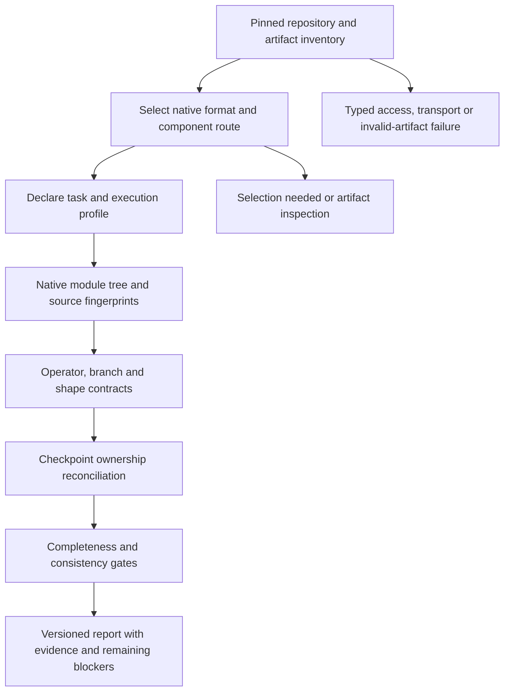

# Dynamic reconstruction: diagnosis and implementation draft

**2026-10-20 — proposed implementation, grounded in saved reports and native source.**

The current engine can construct a valid native module hierarchy while still
being unable to prove every operation, branch, intermediate shape or checkpoint
owner. That is why a valid report can remain partial. This draft defines how to
close those gaps without replacing missing evidence with plausible architecture.
It does not claim that the routes below are already implemented.

## What the debugging established

The diagnosis overlays the latest 22 pinned rechecks onto the previous 250-model
capture. It verifies report bytes against their recorded SHA256, model ID,
revision, engine, warning count and coverage observations before counting them.
There are 245 verified reports: 17 from engine `.3` and 228 from `.2`. Five failed
attempts have no report. This is a mixed-engine backlog, not a new 250-case `.3`
extraction. Historical dropout/activation warnings must be rechecked before
implementing rules already delivered in `.3`.

| Observed partial-report condition | Models | Meaning |
| --- | ---: | --- |
| All four recorded ratios equal 1, no unknown graph node or unmapped checkpoint tensor, but warnings remain | 20 | Existing ratios do not cover all source operations and branches. |
| Coverage, unknown-node or checkpoint-ownership gap | 67 | There is also an unresolved structural or tensor fact. |
| Unresolved source branch | 67 | Config, input, mask, dtype or runtime condition was not established. |
| Opaque call | 64 | Dependencies were retained, but that operation's semantics were not proved. |
| Unresolved loop | 20 | The iterable or iteration contract was outside the supported subset. |
| Checkpoint tensor with no native owner | 11 | Native parameter coverage can be 1 while extra checkpoint tensors remain. |

The first two rows partition the 87 partial reports. The remaining cohorts
overlap. Operation-warning cohorts include numerical-stability calls in 14
models, attention/mask dispatch in 8, split/chunk/unbind in 13, padding/window/
resampling in 6, reductions/normalization in 15, and position-ID helpers in 15.
These are text-classified warning cohorts for prioritization, not verified
operator identities or estimates of the number of models a fix will complete.

The durable evidence is [dynamic-reconstruction-diagnosis.json](benchmarks/dynamic-reconstruction-diagnosis.json).
It lists every pin and report digest, safe blocker counts, engine attribution and
source-capture hashes. No raw exception/warning text or local paths are published.

### Five failures rechecked against Hugging Face

Bounded anonymous probes again returned `401 / GatedRepo` for pinned config and
checkpoint paths of Llama-3.2-1B-Instruct, Prompt-Guard-86M, FLUX.1-schnell and
DeepFloyd IF-I-XL-v1.0. Those failures need token-owner access approval; repeated
anonymous attempts or different graph rules cannot fix access denial. The
existing optional worker `HF_TOKEN` path is available; authenticated success was
not tested here.

The XTTS-v2 config returned 200 after bounded redirects and contained two
non-finite JSON constants. Its requested `model.safetensors` returned 404. The
strict resolver correctly rejects that config before native reconstruction.
An XTTS-specific format route would need an explicit field/format contract and
supported checkpoint evidence; silently deleting or replacing `Infinity` would
change the publisher artifact. See [fresh failure probes](benchmarks/dynamic-failure-probes.json).
No weight payload was read by these probes.

### Concrete source traces on engine `.3`

Installed Transformers version: **4.57.6**. Native source line numbers below refer
to that installed version. Internal analyzer line references refer to commit
`00170dc`, the extraction implementation used for the `.3` rechecks.

| Model | Actual unresolved evidence | Source and required next contract |
| --- | --- | --- |
| T5-small / Flan-T5-small | 25 warnings despite four ratios of 1 | `models/t5/modeling_t5.py`: `T5Block.forward` starts at 671; float16 guards at 701/725/740 and clamp calls at 707/731/746. Track dtype through proven operators, represent numerical-stability operations, and retain guards when dtype is unknown. Masks/cache have separate profile requirements. |
| StarCoder2-3B | One opaque `mask_function`, four ratios of 1 | `models/starcoder2/modeling_starcoder2.py:359`. Resolve the selected native callable through proven config/control flow; a variable's name cannot establish its implementation. |
| Whisper-tiny | Four warnings; shape coverage 0.9391 | `models/whisper/modeling_whisper.py:428-430` has dtype/clamp logic. The decoder's unresolved source-relative loop line 150 is the head-mask validation `zip` at native line 914, separate from the decoder-layer loop at 920. Model this bounded tuple/validation contract explicitly. SpecAugment config and training scope remain distinct. |
| ModernBERT-base | Attention table dispatch, chunk outputs, module coverage 0.9264 and shape coverage 0.6 | `models/modernbert/modeling_modernbert.py:241` splits Wi output with `chunk(2, dim=-1)`; line 500 selects `MODERNBERT_ATTENTION_FUNCTION[...]`. Prove the dispatch target and per-output split shapes, then propagate them through the residual graph. |
| CLAP-HTSAT | 40 warnings; shape coverage 0.8609 | `models/clap/modeling_clap.py`, `ClapAudioLayer.forward` starts at 599: shift/window setup at 608, shift tests at 624/646, partition at 630 and reverse at 643. Add HTSAT spatial/window contracts, padding/interpolation and normalization/reduction contracts. Scalar checkpoint shape `[]` is valid and does not explain missing intermediate graph shapes. |
| SegFormer-b0 | Two unresolved loops; 29 unknown graph nodes; shape coverage 0.4906 | `models/segformer/modeling_segformer.py:406` zips patch embeddings, block stages and norms; 627 zips encoder states with projection modules. Add bounded stage-list/tuple iteration with matching native schedule lengths and output-port contracts. |
| Pythia-70m | Six unowned rotary `inv_freq` tensors, plus opaque chunk/rotary/attention calls | Reconcile installed native buffer ownership against this checkpoint's revision and known legacy layout. Preserve extras until a source-backed conversion proves their role. |
| BERT-base | Four extra pooler/sequence-relationship tensors despite native parameter coverage of 1 | The selected native class is `BertForMaskedLM`; the checkpoint also contains pretraining-head tensors. Separate selected task/head ownership from full checkpoint inventory. Never attach an extra tensor to a convenient module merely to reach 100%. |

The engine explains these outcomes:

- `src/static_flow.py:197-232` explores unresolved conditional branches and marks
  their events conditional; `233-260` handles resolved module-container loops.
- `src/static_flow.py:356` drops shape/dtype/device/ndim attribute knowledge;
  the current abstract value mostly carries dependencies and constants.
- `src/static_flow.py:388-432` has a small identity-checked functional operator
  set. Unsupported operations stay opaque rather than gaining guessed meaning.
- `src/hierarchy.py:184-205` limits several operation/Linear/Conv2d shape rules
  to the validated ViT path; generic family coverage does not inherit those proofs.
- `src/pipeline.py:396-420` measures classified emitted nodes/modules, matched
  native parameters and shaped emitted dataflow edges. These denominators do not
  count every source call, every branch or every supported task profile.
- `service/jobs.py:123-168` correctly keeps reports partial when warnings,
  coverage gaps, unknown nodes or unmapped tensors remain.

Current worker stdout/stderr files are empty; API stderr contains normal startup
messages. Source-analysis warnings live in saved report `analysis_report`, not
necessarily in process stderr. The preview error log separately shows blocked
font requests from the local dependency junction and a Babel large-file notice;
those are preview-serving issues, not causes of model reconstruction partialness.

## Proposed dynamic route

Use one shared evidence/IR pipeline with small family contracts. Selection is
based on inspected artifacts and installed native capabilities, not model-name
patterns or a growing list of handcrafted graphs.



### 1. Plan from actual repository contents

Keep the current immutable revision, bounded inventory and metadata budgets.
Create an inspectable plan listing candidate format routes, selected components,
supported native classes, unresolved selections and why each route was chosen or
rejected. A route cannot require more bytes, dependencies or execution privileges
without recording that requirement. Never pick an arbitrary checkpoint variant.

| Evidence | Route and scope |
| --- | --- |
| Native Transformers config + compatible checkpoint | Existing native meta construction, with explicit task/class matching and family semantic contracts. |
| Sentence Transformers `modules.json` | Reconstruct the declared transformer, pooling, normalization and projection composition. A backbone-only graph cannot establish complete sentence-embedding anatomy. |
| Diffusers `model_index.json` | Discover components; inspect each independently; assemble pipeline edges only from reviewed native source. Scheduler state is distinct from parameterized modules. |
| Speech/codec/vocoder component configs | Separate waveform/mel/token/sample-rate contracts and component ownership. TTS, voice conversion and duplex speech require separate profiles. |
| Video or multimodal components | Require frame/temporal axes, modality bridges and conditioning contracts; reuse proven operators while retaining family layouts. |
| Adapter config | Pin adapter and base separately, validate target/rank/shapes, and report composition evidence. An adapter alone remains incomplete. |
| GGUF / ONNX / other framework artifacts | Use a bounded non-executing format reader before any family graph route. Tensor inventory or an interchange graph does not by itself prove native equivalence. |
| Archived RL or robotics policy | Read safe bounded metadata; select a reviewed native policy contract for state/action/time/modality dimensions. Do not unpickle policy objects or infer architecture from an RL task tag. |
| Missing config, missing safe format, incompatible class | Preserve inventory and an actionable route blocker. Existing 49 no-Safetensors and 49 no-native-route outcomes need distinct solutions. |

### 2. Define completeness against explicit profiles

Record the selected class, task, component, input ranks/layout, dtype assumptions,
attention implementation, training/eval mode, cache behavior, optional masks,
outputs and loss path. Distinguish a canonical inference profile from training,
cached decoding, packed inputs and multimodal variants. Model families do not
all share the same optional arguments or default representations.

A result may prove a specified profile while other profiles remain unsupported;
the product must show both facts. A model-wide completion claim needs all
advertised profiles and components. Passing the text backbone cannot cover an
uninspected audio decoder, sentence pooler, video VAE or task head.

### 3. Expand the abstract interpreter with proven facts

Carry dependency references plus shape/rank, dtype, tuple/dictionary members and
their evidence. Infer a property only when its inputs and transfer contract prove
it. A first parameter's dtype alone cannot establish the dtype of every activation.
Propagate unknowns and join branches conservatively.

Resolve config-only guards from the inspected native config. Handle bounded
`range`, `zip` and `enumerate` only for proven finite lengths/module lists, with
existing node/iteration/time budgets. Retain conditional edges when inputs decide
the branch. Model validation-only branches as such only after proving their
effects and recording any profile preconditions; do not suppress warning strings.

Resolve attention/helper dispatch through exact native dictionaries and proven
keys, recording the selected callable/source fingerprint. Unknown/custom dispatch
remains unresolved. Do not execute publisher code or the model's forward method.

### 4. Add operator contracts with exact shape and dtype behavior

Contracts need native callable identity, a supported signature, preconditions,
symbolic output ports, provenance and negative fixtures. In particular:

- `isinf` preserves shape but produces Boolean values.
- `where` broadcasts condition and both alternatives; it is not universally
  shape-preserving. `clamp` needs its own argument/broadcast/dtype contract.
- `norm`, mean and variance depend on axes/keepdim; transpose `t()` has rank limits.
- `chunk` can return fewer chunks than requested. Prove the split dimension,
  output arity and each output size; do not assign the entire input to every port.
- Window partition/reverse, padding, interpolation and temporal operators need
  family layout and divisibility constraints, not borrowed language-token axes.

Generalize the already tested shape algebra beyond ViT contract by contract.
Separate buffers, aliases, inactive task-head tensors and genuinely unowned
checkpoint extras. Keep total checkpoint element count distinct from unique
native parameter count and selected-task parameter count.

### 5. Gate completion on evidence closure

Retain existing coverage metrics and add planned checks for source-operation
coverage, branch/loop closure, per-output shape/dtype consistency, all-checkpoint
tensor disposition, component/task coverage and profile coverage. Unknown
denominators must stay unknown. A valid graph and a ratio of 1 do not prove that
an omitted operation was represented.

Every blocker should carry a stable code, stage, source/config/tensor evidence,
affected graph path and a concrete next action. Keep warnings visible until a
contract proves the operation/branch or a validated profile explicitly excludes
it. Structural schema validity, static completeness and runtime numerical
equivalence remain separate checks. Runtime behavior is not measured by current
production extraction.

### 6. Make retries and observations useful

Log safe stage outcomes, model/pin, adapter/contract version, source fingerprints,
budget, report digest and diagnostic codes. Keep credentials, signed URLs and raw
provider bodies out of public logs. Distinguish the stage that failed from a
successful extraction that still has semantic gaps.

Retry bounded transport/429/temporary-service errors with backoff. Do not retry
gated 401s, malformed configs or selection ambiguity as if they were transient.
Preserve the original artifact and failure. Proposed diagnostic codes refine
existing statuses; they do not turn a failed extraction into a partial graph.

Persist plans, profiles, blockers and reports in Supabase. Cache identity must
include every extraction-affecting profile, contract set, component/base revision
and artifact selection; adding profiles requires a deliberate registry migration.
Keep `.2`/`.3` reports openable with original provenance. Actual extraction
changes require a new engine identity and new pinned observations; this design
and diagnostics increment does not modify or relabel existing results.

## Delivery order and acceptance

| Increment | Concrete scope | Required evidence |
| --- | --- | --- |
| A — explainability and profiles | Stable blocker records, task/profile scope and operation/branch denominators; source of a partial result visible without opening raw logs. | Existing report compatibility, safe diagnostic serialization and profile-specific cache separation. No change in completion labels without new proof. |
| B — native text and speech closure | T5/Whisper config/dtype/validation paths; StarCoder2 mask dispatch; BERT checkpoint-extra roles. | Tiny positive/negative fixtures, exact native source identities, pinned rechecks and unchanged decoder-only controls. |
| C — tuple outputs and shape propagation | ModernBERT chunk/attention dispatch; Pythia rotary/buffer mapping; SegFormer stage iteration. | Correct output arity, shapes/dtypes, ownership and branch-edge fixtures; compare unknown/shape gaps before and after. |
| D — spatial/audio/video contracts | CLAP windows/padding/resampling, codec/audio representations, temporal layouts. | Layout, scalar, divisibility, reduction and modality-edge tests per family; preserve unsupported profiles. |
| E — additional runtime libraries/formats | Diffusers composition, sentence-embedding composition, adapters/base, RL/robotics and safe interchange readers. | Separate optional dependency/native-construction review, component ownership, task-specific I/O and pinned end-to-end fixtures. |

For each implementation: inspect the diff; run relevant unit/compiler/lint
checks; rerun changed cases plus positive and negative controls; verify storage/
API/graph/export round trips; publish a new attributable observation. Recheck
the older `.2` cohorts before spending work on already-fixed operator gaps.
Do not infer that a shared symptom guarantees one shared implementation fix.

## Reproduce the current diagnosis

```powershell
python scripts/diagnose_saved_reports.py --source .local/supabase-alignment-runtime/capture.ndjson .local/supabase-alignment-runtime/reports --source .local/model-coverage-runtime/final-rechecks.ndjson .local/model-coverage-runtime/final-reports --output docs/benchmarks/dynamic-reconstruction-diagnosis.json
```

Sources overlay in the given order. A later observation must preserve the same
model pin. Digest/identity/metric mismatches fail the diagnostic export. Raw
reports remain in private storage; the committed output is a blocker inventory,
not a replacement report or a fresh extraction.

## Verification of this draft and diagnostic tool

- Full offline suite: **583 passed**, 1 skipped, 18 integration tests deselected.
  One dependency deprecation warning remains from Starlette/httpx.
- Ruff across backend/scripts/infra, Python compilation and diff checks pass.
- The 250-case export verifies 245 saved reports; unit fixtures reject tampered
  digests, changed pins/engines/metrics, malformed containers, Boolean ratios and
  completion labels that contradict unresolved warnings. Artifact-only schemas
  stay distinct from architecture schemas.
- Two diagnostic evidence files are preserved in private Supabase Storage with
  digest/read-back verification. See [archive receipts](benchmarks/dynamic-diagnosis-archive.json).
- No production extraction, API, frontend or report-label change is included.
  The live service remains on engine `.3`; the inherited frontend formatting
  gate and the preview font-serving warning are outside this draft increment.
