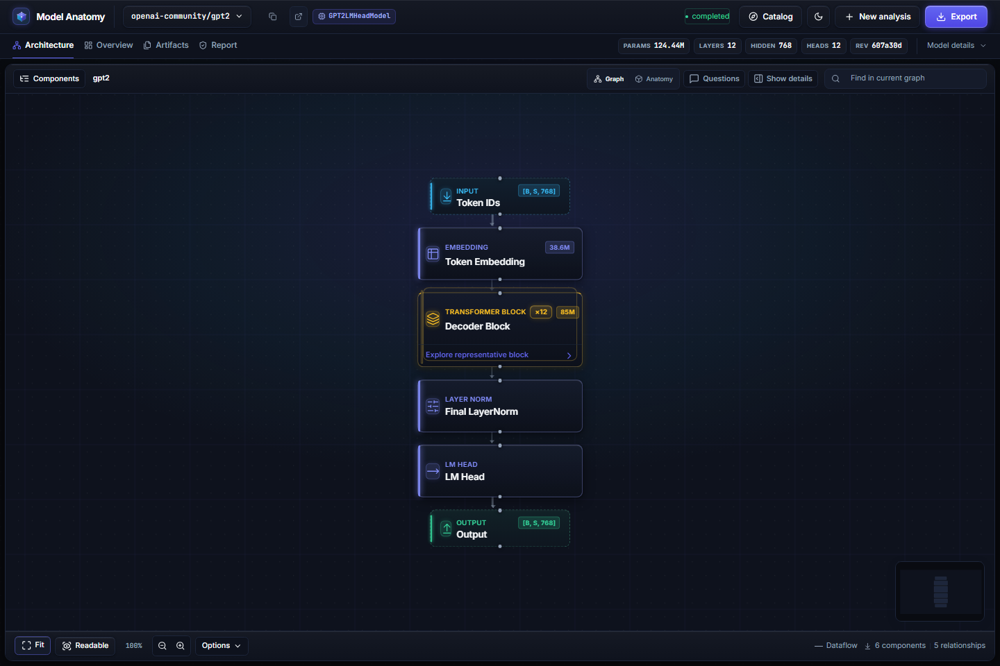
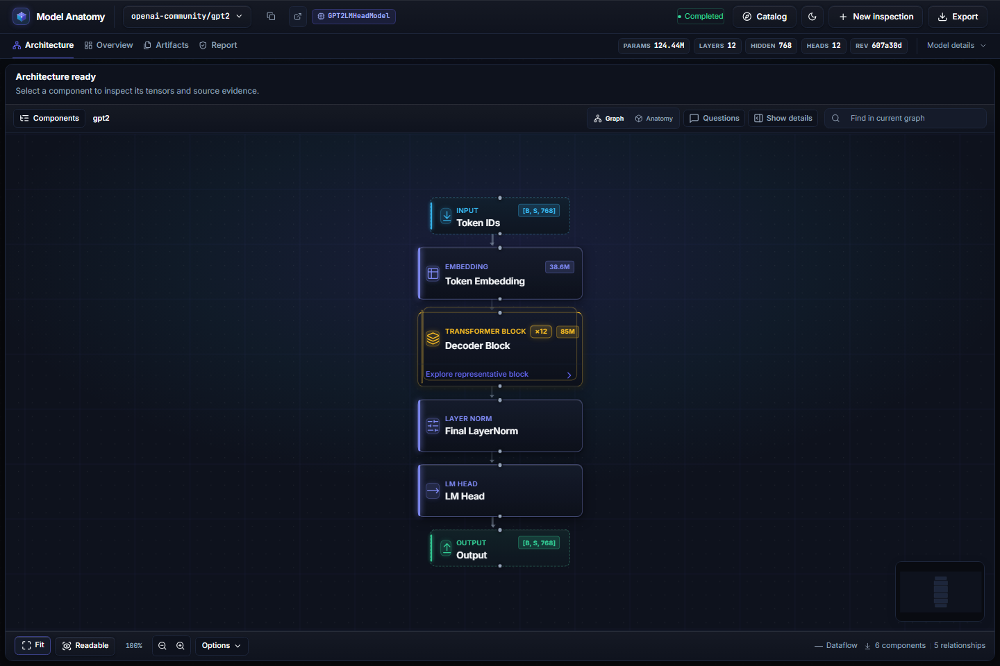
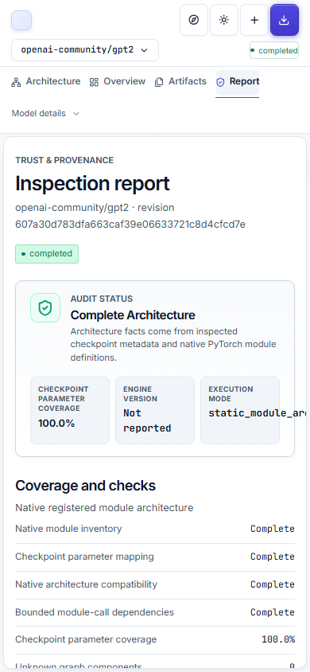
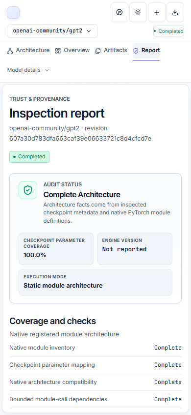
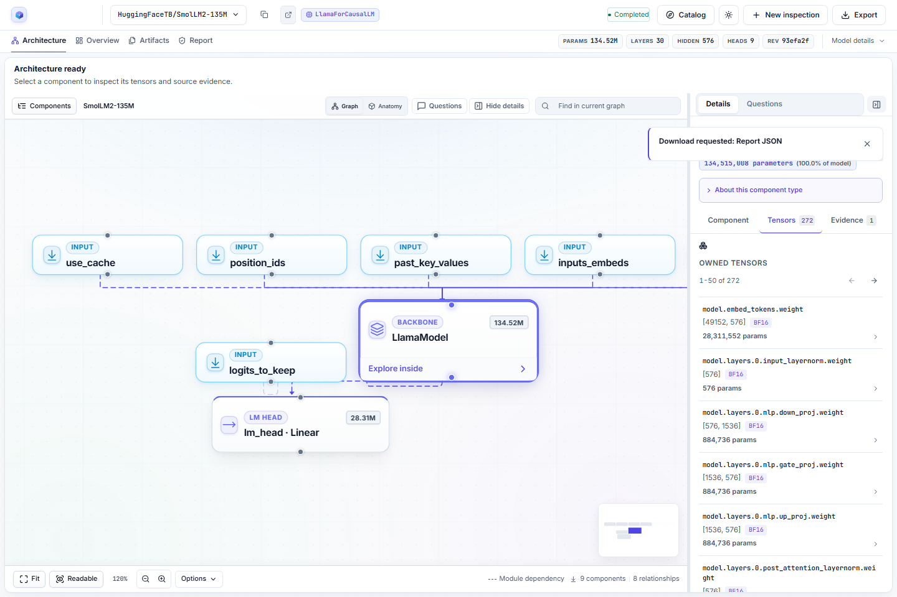

# Frontend journey and feedback polish

Branch: `codex/ux-journey-polish`; baseline: `feat/vv` at `3264d9b`.
Implemented 26–27 October 2026. Backend APIs, quota rules and extraction contracts are unchanged.

## Acceptance checklist

- [x] Clipboard confirmation waits for a resolved write; rejection offers a local manual fallback.
- [x] Exports announce “Download requested” with the actual format after preparation; failure remains inline with explicit retry.
- [x] Accessible Radix notices are limited to two, replace matching operation IDs, expire after six seconds and pause during interaction/blur.
- [x] Historical completions stay silent; observed background completions link to the result; active-result completions stay silent.
- [x] Invalid references remain associated with the model field; input survives failure and errors clear on editing.
- [x] An uncertain submission links to Your inspections before retry. Pending submission and export actions are guarded.
- [x] Checking, available, saved-only and unavailable service states are distinct. Worker-offline cache lookup remains possible; database/storage failures disable submissions.
- [x] Queue/allowance failures preserve the server-provided explanation; mutation retries require an explicit action.
- [x] Progress announces human-readable stages, shows cancellation state and explains background continuation.
- [x] Complete, partial, artifact-only, missing/expired and unsuccessful outcomes provide relevant next actions.
- [x] The complete-architecture claim still requires all four backend checks to be exactly true.
- [x] Empty catalogs offer an inspection CTA; populated catalogs expose filters and unmatched searches offer Clear filters.
- [x] Saved-report actions and new inspections have separate labels; previous-report failures stay visible on their exact record.
- [x] Question drafts survive failures; citation failures support retry; unavailable questions explain alternatives once.
- [x] Technical codes/request IDs and secondary metadata use disclosures; evidence and limitations remain available.
- [x] Component selection, inspector tabs, graph return, themes, reduced motion, keyboard interaction and equivalent 200% reflow remain covered.
- [x] Support opens the help disclosure; help, history and form links focus their destinations; phones can copy the model ID; report metadata wraps without clipping.
- [x] Light-theme output labels meet the measured contrast requirement; dark-theme colors remain unchanged.

## Verification

- Production build and TypeScript compile passed. Vite retains its existing advisory for chunks larger than 500 kB.
- All 42 focused feedback, recovery, screenshot and reflow cases passed on the built frontend, including both desktop and phone projects.
- The broad production sweep passed 239 cases and skipped 36 explicitly opt-in live/publication cases. Its eleven failures were inspected and addressed. The final affected-journey run passed 131 cases; its three remaining fixture/navigation-test failures were corrected and all four targeted desktop/phone reruns passed. Across the sweep and reruns, all 252 non-opt-in cases (including the two new navigation cases) were exercised successfully. This is combined coverage across runs, not a claim of a single fresh all-green full-suite run.
- A real API/worker run inspected `HuggingFaceTB/SmolLM2-135M` at revision `93efa2f097d58c2a74874c7e644dbc9b0cee75a2`: fresh report (`cached=false`), 134,515,008 parameters, component tensor/evidence inspection, actual JSON download, then normal UI reopen (`cached=true`) at the same revision. The exported report recorded zero weight payload bytes read.
- AI inference is unavailable in this local profile. Disabled-AI, draft retention, question failure and citation recovery use isolated HTTP contract fixtures; no live AI result is claimed.
- The initial development-server suite exposed stale selectors and slow lazy-module loading under concurrent tests. Expectations were migrated to intended behavior, and final validation uses the production build. Failures were inspected rather than hidden by blanket timeouts or automatic retries.
- The fixture graph index now derives its root label from the scenario's model ID; this fixes the long-phone-breadcrumb test without relabeling the application. Phone anatomy tests return from the inspector before acting on the assembly. Null activation shapes stay omitted, with their limitation stated explicitly.

Reproduce frontend regression checks with the commands in `AGENTS.md`. To avoid development transform contention locally, run `npm run build`, start `npx vite preview --host 127.0.0.1 --port 5175 --strictPort`, and use `E2E_BASE_URL=http://127.0.0.1:5175 npx playwright test --workers=2` (set environment variables using your shell).

The opt-in real journey is `e2e/ux-live.spec.ts`, enabled with `UX_LIVE_API=1` and a running API/worker. The local launcher connects port 5173 to API port 8000. This test forces one fresh metadata inspection, then exercises the ordinary cached UI path.

## Screenshots

The before/after images below use explicit HTTP contract fixtures to compare presentation. They are UI snapshots, not evidence of model reconstruction. Before images were captured at the baseline above. Review covered 1440, 768 and 390 CSS pixels, both themes and reduced motion; the selected-component capture now waits for the component heading to load.

| View | Before | After |
| --- | --- | --- |
| Workspace, 1440 dark |  |  |
| Report, 390 light |  |  |

[Selected component on phone](evidence/ux-journey-2026-10-27/selected-after-390.png) · [768 light workspace](evidence/ux-journey-2026-10-27/graph-after-768-light.png)

The following screenshot comes from the real pinned inspection described above, not a prepared fixture:

