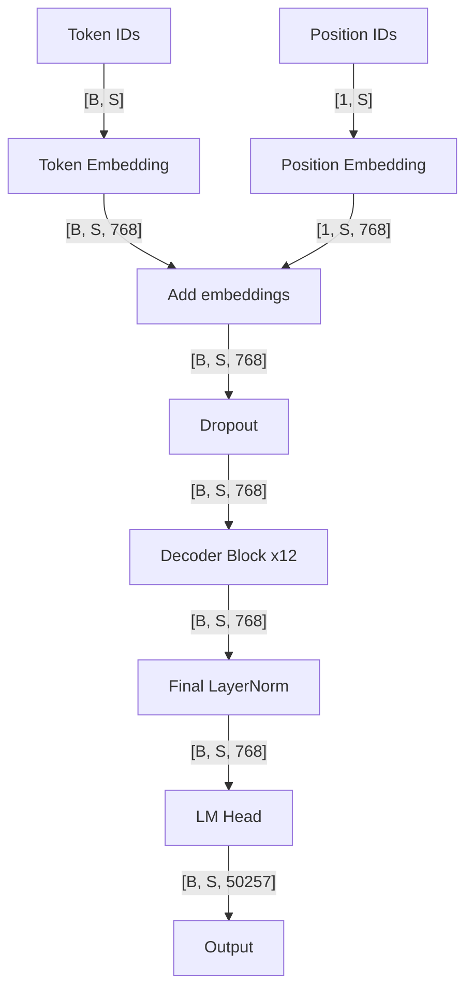
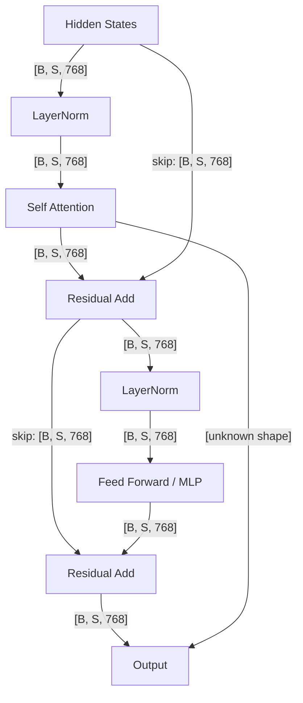
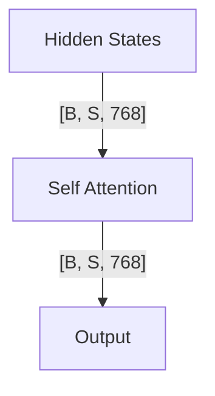
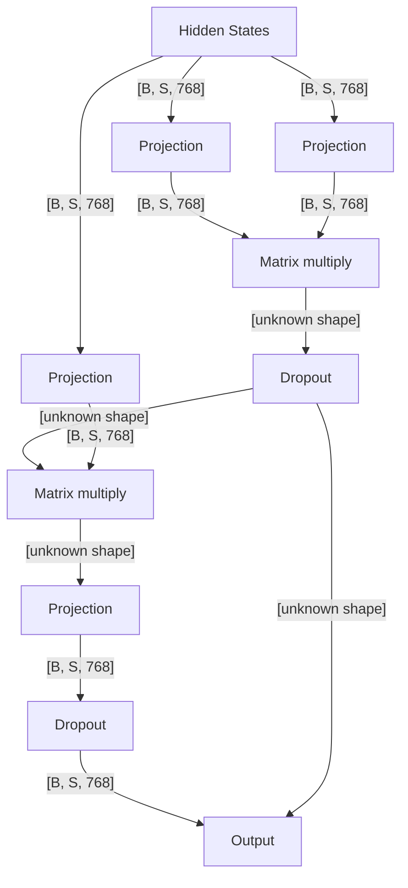
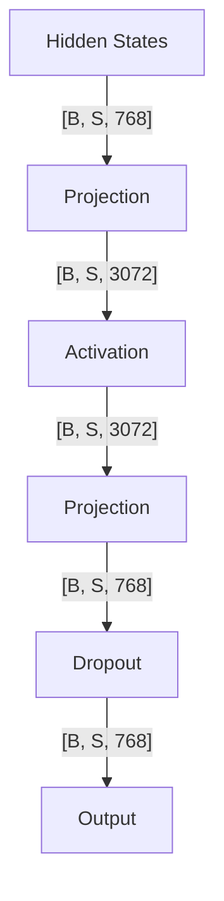

# GPTNeoForCausalLM Hierarchy Preview

Model: `EleutherAI/gpt-neo-125m` | Revision: `21def0189f5705e2521767faed922f1f15e7d7db`

These graphs are generated from the same Hierarchical Model IR. Solid edges represent static source or pattern dataflow; dotted edges represent structural relationships. No forward pass was executed.

Child graphs of repeated nodes show a representative instance. All instance paths and parameters remain in the raw structure. Unknown shapes and components are explicitly marked.

## overview

## transformer_h_0

## transformer_h_0_attn

## transformer_h_0_attn_attention

## transformer_h_0_mlp

