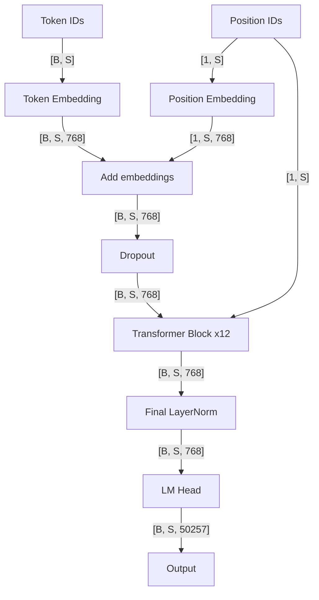
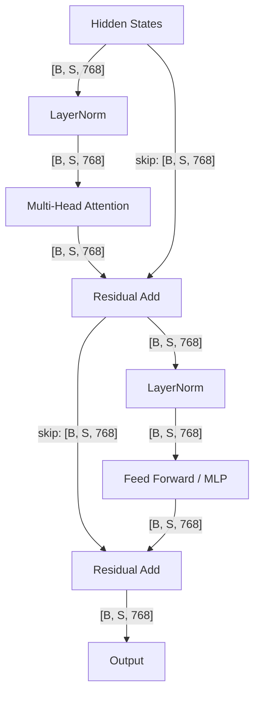
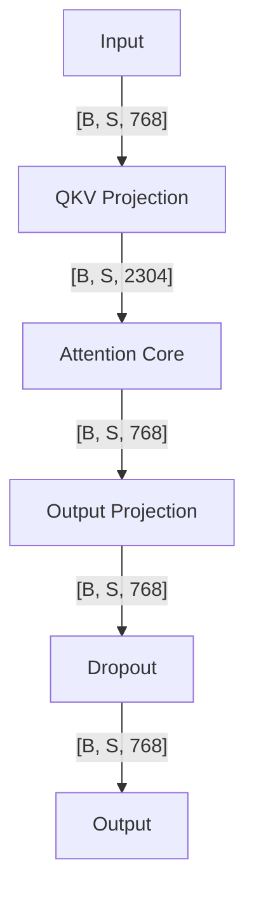
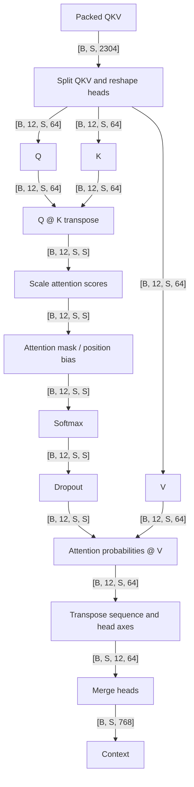
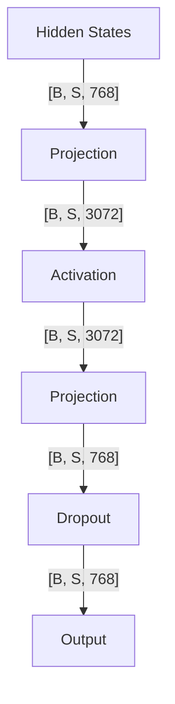

# GPT2LMHeadModel Hierarchy Preview

Model: `openai-community/gpt2` | Revision: `607a30d783dfa663caf39e06633721c8d4cfcd7e`

These graphs are generated from the same Hierarchical Model IR. Solid edges represent static source or pattern dataflow; dotted edges represent structural relationships. No forward pass was executed.

Child graphs of repeated nodes show a representative instance. All instance paths and parameters remain in the raw structure. Unknown shapes and components are explicitly marked.

## overview

## transformer_block

## attention

## attention_core

## feed_forward

